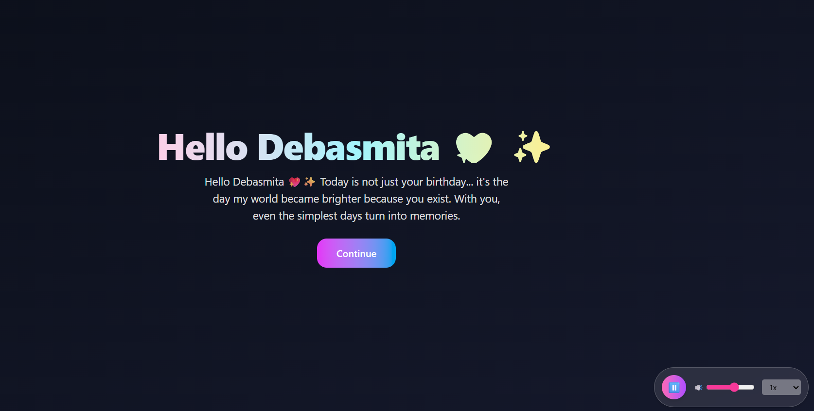
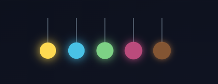
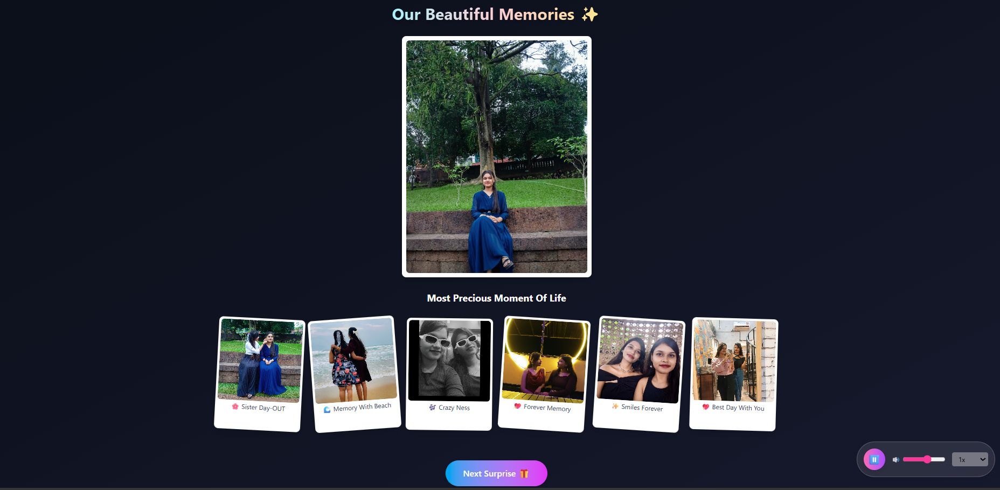
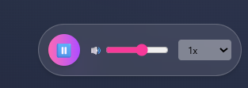
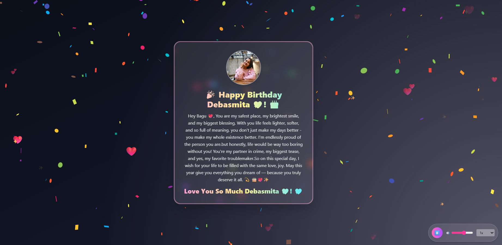
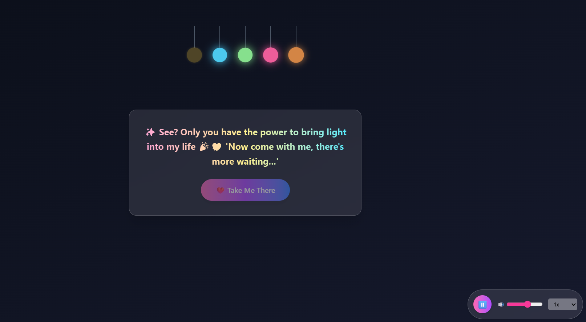

# 🎂 Interactive Birthday Wish Website

<p align="center">
  
  
  
  
</p>

<p align="center">
  💖 A personalized interactive birthday experience created to turn memories, animations, music, and heartfelt messages into a fun digital surprise.
</p>

<p align="center">
  🌐 <a href="https://bdy-nu-three.vercel.app/" target="_blank"><strong>Live Website</strong></a>
  •
  ⭐ <a href="https://github.com/subhasmita-puja/bdy" target="_blank"><strong>Repository</strong></a>
</p>

---

## 🌟 About the Project

The **Interactive Birthday Wish Website** is a personalized web experience created as a fun digital surprise for my sister.

Instead of a traditional birthday message, the website transforms the celebration into a **multi-step interactive journey** with animated messages, music, lights, memories, confetti, floating hearts, and a final personalized birthday message.

> **"A small digital surprise filled with memories, music, animation, and lots of love."** 💖

---

## ✨ Features

### 💌 Personalized Welcome

* Personalized greeting message
* Animated typing effect
* Smooth entrance animations
* Interactive **Continue** experience

### 💡 Interactive Light-Up Experience

* Dark-to-light interactive scene
* Animated decorative lights
* Glowing light effects
* Music-triggered light activation
* Interactive transition to the next experience

### 🎵 Interactive Music Player

* Play / Pause controls
* Volume adjustment
* Playback speed control
* Supports speeds from **0.5x to 2x**
* Looping background music
* Responsive mobile music controls
* Audio error handling

### 🖼️ Memory Gallery

* Large featured memory
* Multiple personalized photographs
* Individual captions
* Animated photo cards
* Floating/rotating card animations
* Responsive gallery layout

### 🎉 Celebration Experience

* Full-screen confetti effect
* Animated floating hearts
* Sparkle effects
* Animated gradient background
* Glowing birthday card
* Personalized birthday message
* Final animated birthday greeting

### 🎨 Interactive UI

* Glassmorphism cards
* Gradient typography
* Smooth page transitions
* Hover and tap interactions
* Responsive design
* Mobile-friendly layout

---

## 🧩 Experience Flow

```text
Welcome
   ↓
Personalized Message
   ↓
Interactive Light-Up
   ↓
Music & Lights
   ↓
Memory Gallery
   ↓
Next Surprise
   ↓
Confetti Celebration
   ↓
Final Birthday Message
```

---

## 🖼️ Screenshots

| Welcome Experience | Interactive Light-Up | Memory Gallery |
|--------------------|----------------------|----------------|
|  |  |  |

| Music Player | Celebration | Birthday Wish |
|--------------|-------------|---------------------|
|  |  |  |
---

## 🧠 What I Learned

* Creating **multi-step interactive experiences** with React
* Building smooth UI transitions using **Framer Motion**
* Implementing a custom **HTML5 audio player**
* Handling audio volume and playback speed dynamically
* Creating responsive image galleries
* Building animated celebration effects with **confetti and motion**
* Managing component state across multiple interactive stages
* Designing personalized experiences with responsive layouts
* Combining animation, media, and user interaction into one cohesive experience

---

## 🚀 Project Highlights

| Feature                  | Description                              |
| ------------------------ | ---------------------------------------- |
| 💌 Personalized Messages | Dynamic animated birthday messages       |
| ⌨️ Typing Effect         | Character-by-character message animation |
| 💡 Light Interaction     | Music-triggered animated lights          |
| 🎵 Music Player          | Playback, volume and speed controls      |
| 🖼️ Memory Gallery       | Personalized photos with captions        |
| 🎉 Confetti              | Full-screen celebration effect           |
| 💖 Floating Hearts       | Animated decorative elements             |
| ✨ Sparkles               | Continuous background effects            |
| 🎨 Glassmorphism         | Modern translucent UI                    |
| 📱 Responsive            | Mobile, tablet and desktop support       |

---

## 📱 Responsive Design

The experience is designed to work across:

* 📱 Mobile devices
* 📲 Tablets
* 💻 Laptops
* 🖥️ Desktop screens

The music controls, gallery, typography, cards, buttons, and animations adapt to different screen sizes.

---

## 🔗 Project Links

🌐 **Live Website**
https://bdy-nu-three.vercel.app/

💻 **GitHub Repository**
https://github.com/subhasmita-puja/bdy

---

## 👩‍💻 About the Developer

**Subhasmita Sahoo**

Frontend Developer | MERN Stack Developer | 3D Web Enthusiast

📍 Odisha, India

🔗 [GitHub](https://github.com/subhasmita-puja)
🔗 [LinkedIn](https://www.linkedin.com/in/subhasmita-sahoo-puja)

---

## 💖 Purpose

This project was created as a **personal creative project** to make a birthday celebration more memorable through technology.

It combines:

**Memories + Music + Animation + Interaction + Personalization**

into one small digital experience. 🎂✨

---

## 🪷 License

This project is available under the **MIT License**.
